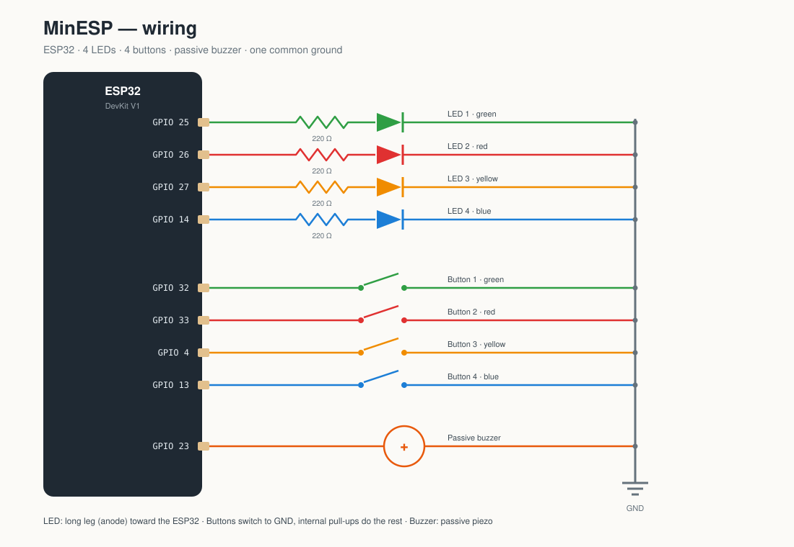

# MinESP — ESP32 Memory Game

A Simon-style memory game: four LEDs show a pattern that grows by one step each
round, you repeat it on the four buttons, and a buzzer tells you how you did.

```
        ┌──────────────┐
        │   ESP32      │
 LED 1 ─┤25         23 ├─ Buzzer +
 LED 2 ─┤26         32 ├─ Button 1 ── GND
 LED 3 ─┤27         33 ├─ Button 2 ── GND
 LED 4 ─┤14          4 ├─ Button 3 ── GND
        │            13 ├─ Button 4 ── GND
        │           GND ├─ common ground
        └──────────────┘
```

Sketch: [`MinESP/MinESP.ino`](MinESP/MinESP.ino) · Diagram: [`wiring.svg`](wiring.svg)

---

## Parts

| Qty | Part |
|----:|------|
| 1 | ESP32 dev board (classic ESP32-WROOM DevKit — the GPIO numbers below only exist on classic ESP32) |
| 4 | LEDs (green, red, yellow, blue works nicely) |
| 4 | Resistors, 220–330 Ω |
| 4 | Momentary push buttons |
| 1 | **Passive** piezo buzzer |
| — | Breadboard + jumper wires |

---

## Wiring



Buttons use the ESP32's internal pull-ups, so each button only needs one wire to
a GPIO and one to GND. LEDs need a series resistor.

| Function | ESP32 pin | Goes to |
|---|---|---|
| LED 1 (green) | GPIO 25 | 220 Ω → LED anode; LED cathode → GND |
| LED 2 (red) | GPIO 26 | 220 Ω → LED anode; LED cathode → GND |
| LED 3 (yellow) | GPIO 27 | 220 Ω → LED anode; LED cathode → GND |
| LED 4 (blue) | GPIO 14 | 220 Ω → LED anode; LED cathode → GND |
| Button 1 (green) | GPIO 32 | other leg → GND |
| Button 2 (red) | GPIO 33 | other leg → GND |
| Button 3 (yellow) | GPIO 4 | other leg → GND |
| Button 4 (blue) | GPIO 13 | other leg → GND |
| Buzzer + | GPIO 23 | buzzer − → GND |

```
  ESP32                                     breadboard

  GPIO25 ──[220Ω]──▶|── GND                 LED 1
  GPIO26 ──[220Ω]──▶|── GND                 LED 2
  GPIO27 ──[220Ω]──▶|── GND                 LED 3
  GPIO14 ──[220Ω]──▶|── GND                 LED 4

  GPIO32 ──o  o── GND                       Button 1
  GPIO33 ──o  o── GND                       Button 2
  GPIO4  ──o  o── GND                       Button 3
  GPIO13 ──o  o── GND                       Button 4

  GPIO23 ──(+) buzzer (−)── GND             Buzzer
```

The LED's **long leg is the anode (+)** and goes toward the ESP32; the short leg
goes to GND. All grounds are the same net — tie them to one ESP32 GND pin.

---

## Flash it

1. Install the Arduino IDE and the **esp32** board package
   (Boards Manager URL: `https://espressif.github.io/arduino-esp32/package_esp32_index.json`).
2. Open `MinESP/MinESP.ino`. The sketch must stay in a folder with the same name,
   which is why it lives in `MinESP/` and not directly in the project root.
3. Tools → Board → **ESP32 Dev Module**.
4. Tools → Port → your board's COM port.
5. Upload. If it hangs on `Connecting........`, hold **BOOT** while it connects.
6. Open Serial Monitor at **115200 baud** to see levels, the pattern and your best score.

---

## How to play

1. Press any button — the startup chase lights invite you in.
2. Watch the LEDs: level 1 shows 1 step, level 2 shows 2 steps, and so on.
3. Press the buttons in the same order.
   - Correct button → short blip in that pad's note, LED flashes.
   - Wrong button or out of time → all four LEDs flash and a low buzz sounds.
4. Clear the round → arpeggio, level up, one more step is added.
5. Your best score is saved in flash (NVS), so it survives a power cycle.

You get 5 s plus 0.4 s per level to make each press (capped at 9 s), and the
pattern plays faster after level 3 to keep it interesting.

### Sound cheat sheet

| Event | What you hear |
|---|---|
| Pad shown / pressed correctly | C4, E4, G4 or C5 (one per pad) |
| Pattern finished, your turn | two quick high blips |
| Round cleared | C-E-G-C arpeggio |
| Wrong button / timeout | three low buzzes + a long drop |

---

## Tuning it

Everything lives at the top of `MinESP/MinESP.ino`:

| Constant | Default | What it does |
|---|---:|---|
| `LED_PIN[]`, `BTN_PIN[]` | 25/26/27/14, 32/33/4/13 | Pin map |
| `BUZZER_PIN` | 23 | Buzzer pin |
| `PAD_NOTE[]` | 262, 330, 392, 523 | Note per pad (Hz) |
| `SHOW_ON_MS` | 320 | LED on time when showing a step |
| `MIN_SHOW_ON_MS` | 170 | Fastest it gets |
| `SHOW_SPEEDUP` | 8 | ms shaved off each level |
| `SHOW_GAP_MS` | 150 | Pause between steps |
| `INPUT_BASE_MS` | 5000 | Base time per press |
| `INPUT_PER_LEVEL_MS` | 400 | Extra time per level |
| `INPUT_MAX_MS` | 9000 | Hard cap on that time |
| `MAX_STEPS` | 40 | Sequence buffer size |
| `LED_ON` / `LED_OFF` | `HIGH` / `LOW` | Swap if your LEDs are active-low |

Want it easier? Raise `SHOW_ON_MS` and `SHOW_GAP_MS`, or lower `SHOW_SPEEDUP`.
Want it meaner? Drop `INPUT_BASE_MS` to 3000.

---

## If something is wrong

| Symptom | Likely fix |
|---|---|
| No sound at all | Check +/− wiring and that it's on GPIO 23; try another GPIO. Use a **passive** buzzer — an active one still beeps, but every note sounds the same |
| LEDs never light | Anode/cathode backwards, missing resistor to the right GPIO, or `LED_ON`/`LED_OFF` need swapping |
| A button never registers | Wrong GPIO, or a wire in the wrong row — check continuity to GND when pressed |
| Random/ghost presses | Loose ground; keep button wires short |
| Serial Monitor is empty | Wrong baud (115200) or wrong port |
| Upload fails | Hold BOOT during "Connecting…", or install the CP210x/CH34x USB driver |
| High score resets | “Erase Flash: All Flash Contents” was used, or NVS is full |

### Remapping notes

- GPIO 34–39 are **input-only and have no internal pull-ups** — if you move a
  button there, add a 10 kΩ resistor from the pin to 3V3.
- Avoid GPIO 0, 2, 5, 12 and 15 for new pins; they're boot-strapping pins.
- GPIO 6–11 are connected to the on-board flash — never use them.

---

## Arduino Uno build

The same game ported to the Uno (SMD/DIP): [`SimonMemory_Uno/SimonMemory_Uno.ino`](SimonMemory_Uno/SimonMemory_Uno.ino) · Diagram: [`wiring_uno.svg`](wiring_uno.svg)

| LEDs (via 220 Ω) | Buttons (to GND) | Buzzer | LCD |
|---|---|---|---|
| D5, D6, D7, D8 | D2, D3, D4, D9 | D10 (passive) | SDA→A4, SCL→A5, VCC→5V, GND→GND |

Flash it: install the **Arduino AVR Boards** core, open the sketch, board **Arduino Uno**, upload. Needs the **LiquidCrystal I2C** library (1.1.2).
